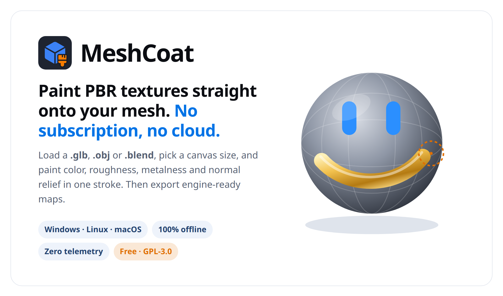
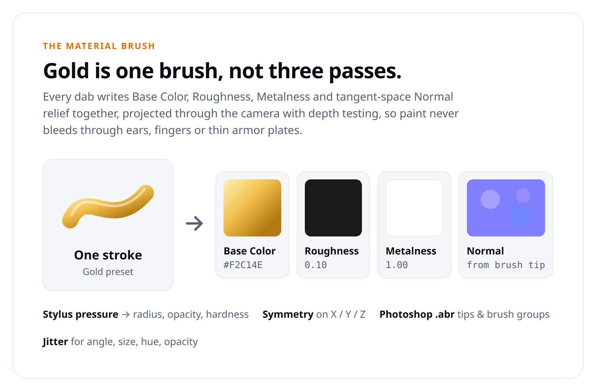
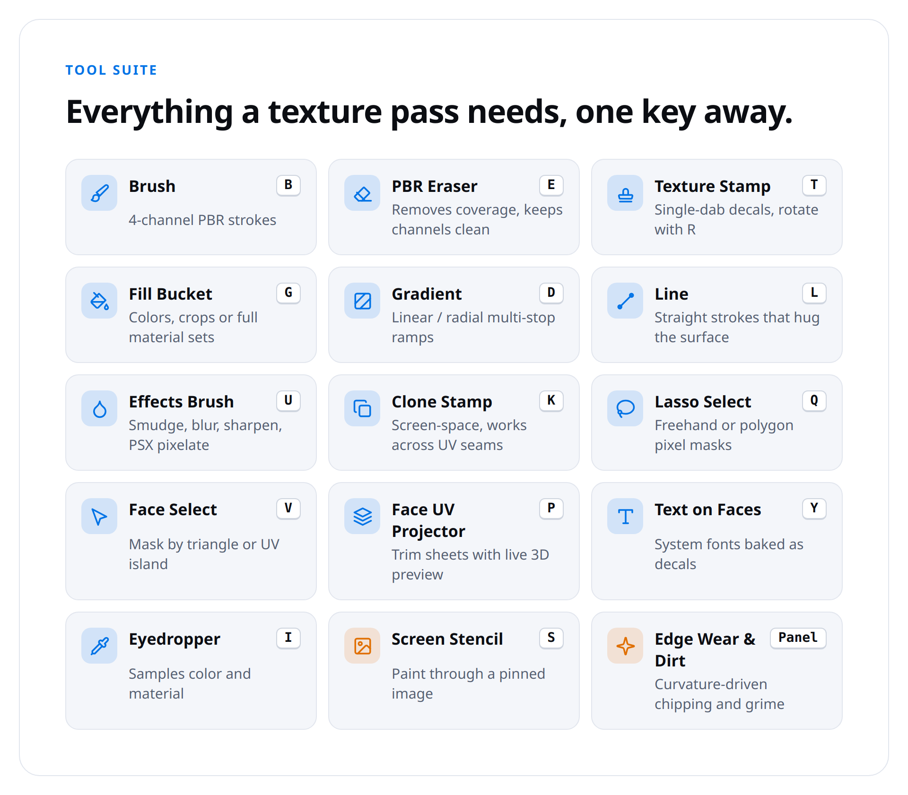
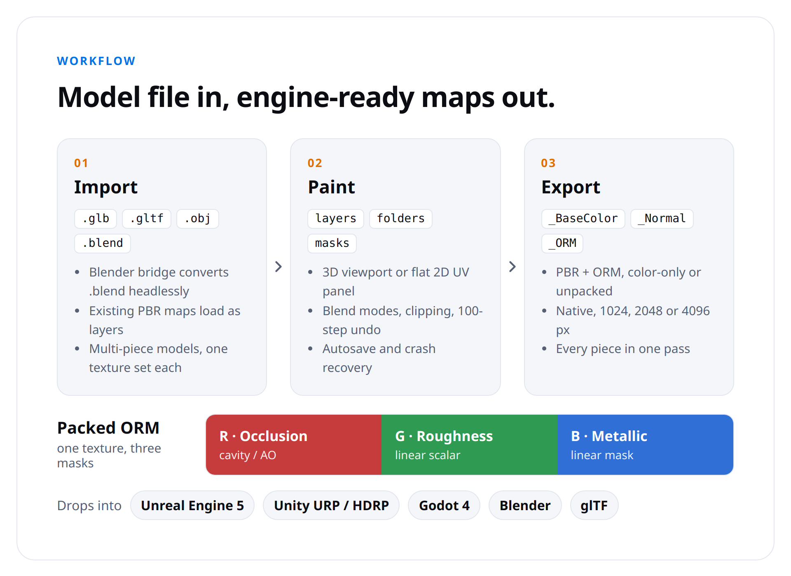
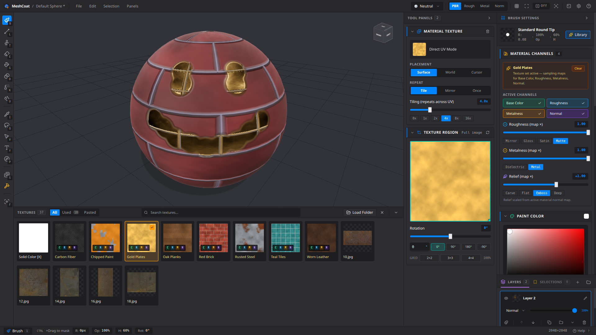
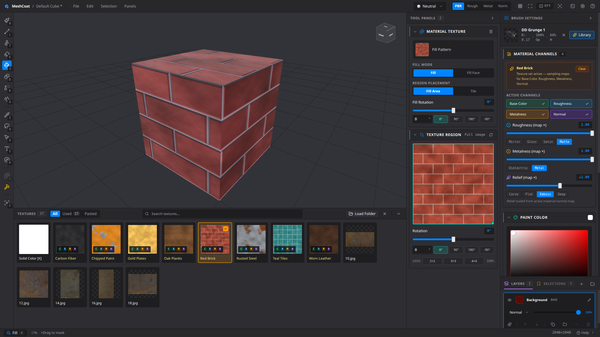
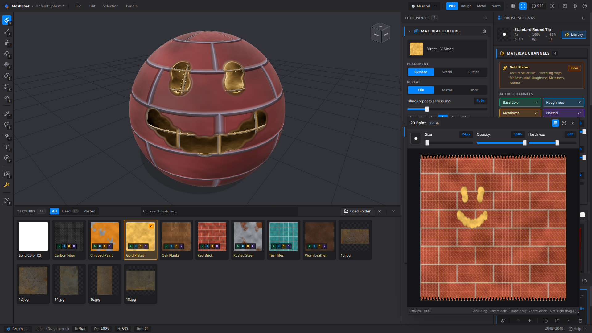
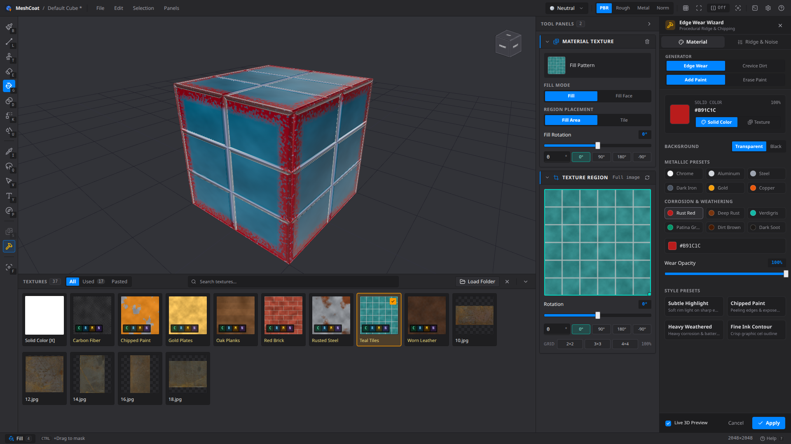
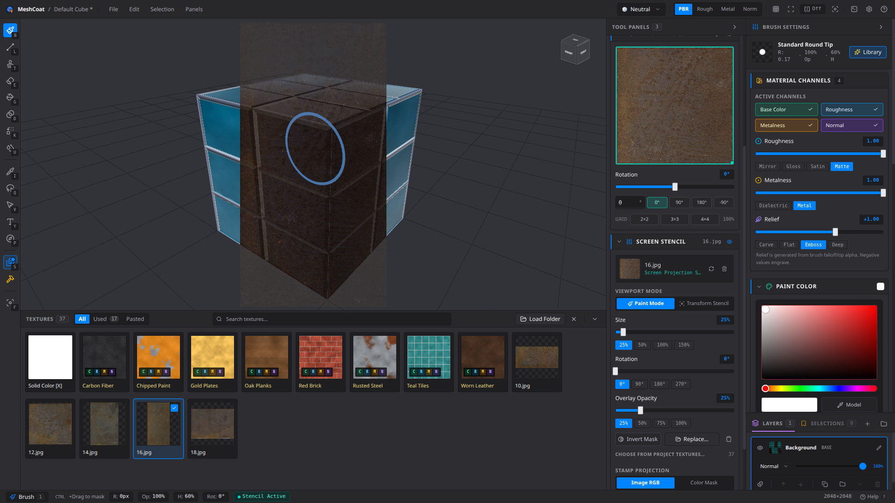
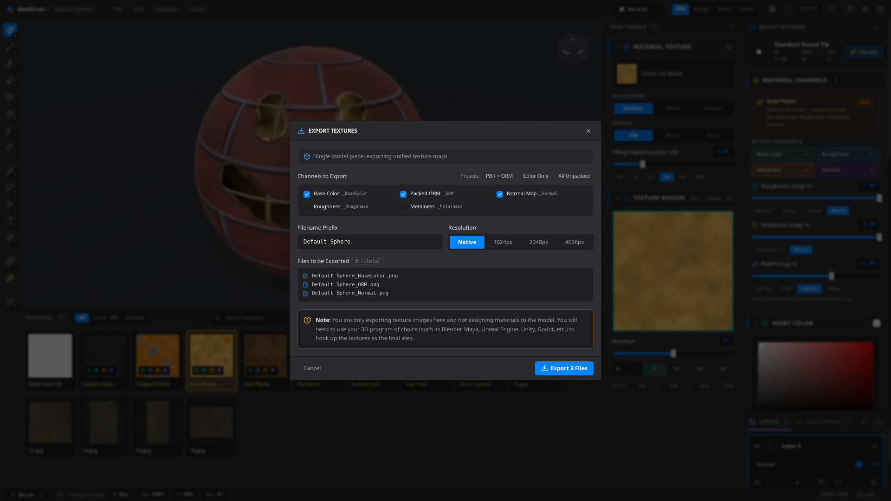

<!-- hypedoc:start -->
<!-- Generated by HypeDoc. Edit the .html sources and run `hypedoc build`; changes inside this block are overwritten. -->
<p align="center">
  <picture>
    <source media="(prefers-color-scheme: dark)" srcset=".hypedoc/img/01-hero.dark.png">
    <source media="(prefers-color-scheme: light)" srcset=".hypedoc/img/01-hero.light.png">
    
  </picture>
</p>
<p align="center">
  <picture>
    <source media="(prefers-color-scheme: dark)" srcset=".hypedoc/img/02-material-brush.dark.png">
    <source media="(prefers-color-scheme: light)" srcset=".hypedoc/img/02-material-brush.light.png">
    
  </picture>
</p>
<p align="center">
  <picture>
    <source media="(prefers-color-scheme: dark)" srcset=".hypedoc/img/03-tools.dark.png">
    <source media="(prefers-color-scheme: light)" srcset=".hypedoc/img/03-tools.light.png">
    
  </picture>
</p>
<p align="center">
  <picture>
    <source media="(prefers-color-scheme: dark)" srcset=".hypedoc/img/04-pipeline.dark.png">
    <source media="(prefers-color-scheme: light)" srcset=".hypedoc/img/04-pipeline.light.png">
    
  </picture>
</p>
<!-- hypedoc:end -->

<p align="center">
  <a href="https://github.com/stuyk/meshcoat/releases">
    
  </a>
  <a href="LICENSE">
    
  </a>
  <a href="CHANGELOG.md">
    
  </a>
</p>

Most texturing suites have grown into multi-gigabyte installs with monthly subscriptions, which is a lot to ask when all you want is to paint a low-poly prop.

MeshCoat is a desktop texture painter built for game developers and 3D artists. Open a model, pick a canvas resolution, and paint on the mesh within seconds. It needs no account, sends no telemetry and makes no network calls. Your models and textures stay on your machine.

<p align="center">
  
  
</p>
<p align="center">
  
  
</p>
<p align="center">
  
  
</p>

---

## Getting Started

1. **Download** the build for your platform from [Releases](https://github.com/stuyk/meshcoat/releases):
   - **Windows:** installer (`MeshCoat-Windows-Setup-*.exe`) or portable `.exe`
   - **Linux:** `AppImage`, `.deb` or `.tar.gz`
   - **macOS:** `.dmg` (not notarized, so right-click → Open on first launch)
2. **Open a model** with `Ctrl+N` (start wizard) or `Ctrl+O`. Try `.glb`, `.gltf`, `.obj` or `.blend`.
3. **Pick a canvas size** per piece. Existing material maps on the model are imported as layers.
4. **Paint.** Press `?` at any time for the searchable hotkey and help guide.
5. **Save** with `Ctrl+S` to a `.meshcoat` project, and **export** textures with `Ctrl+E`.

> Opening `.blend` files needs a local Blender install. MeshCoat runs it headlessly to convert the file, and asks for the executable if it can't find one.

---

## Features

### Painting
- **Material brush.** One stroke writes Base Color, Roughness, Metalness and tangent-space Normal relief together. Toggle any channel off to paint just the ones you want.
- **Camera projection with depth testing.** Paint lands only on surfaces you can see, with normal-angle falloff, so it doesn't bleed through thin geometry or onto back faces.
- **Photoshop `.abr` brushes.** Import brush packs with tip previews, spacing, angle and size jitter, and automatic normal relief. Brush groups swap between several tips per stroke or per dab.
- **Randomness.** Hue, saturation, lightness, opacity, angle and size jitter, re-rolled per dab or per stroke. Chaos turns on a mix of all of them at once.
- **Stylus pressure.** Pen pressure maps separately to radius, opacity and hardness. Supports Wacom and Windows Ink.
- **Symmetry.** Mirror painting across X, Y or Z with an adjustable plane offset.
- **2D Paint Panel.** A floating flat view of the active texture with a UV wireframe overlay. Dabs are exact circles in texture pixels, and fill, eyedropper and face select work there too.

### Selection & projection
- **Face selection** by triangle, drag, or connected UV island. Every tool stays inside the selection.
- **Lasso selection** (freehand or polygon) cuts across faces and stays fixed to the surface while you orbit.
- **Face UV Projector** places trim sheets and decals on selected faces, with a lit 3D preview, offset, rotation and fit-to-selection.
- **Screen Stencil** pins an image to the camera. Orbit underneath it and paint through it, or stamp the whole image onto the model.
- **Clipboard paste.** `Ctrl+V` puts any copied image straight into the texture shelf or stencil.

### Procedural
- **Edge Wear & Crevice Dirt.** Curvature analysis finds convex ridges for chipping and concave folds for grime, with presets, a live preview, and an erase mode for wearing paint away.

### Layers & projects
- **Layer stack** with blend modes (Normal, Multiply, Screen, Overlay, Luminosity and more), opacity, grayscale masks, clipping, and folders (`Ctrl+G`).
- **Merge Down** bakes blend mode, opacity and clipping in exactly as displayed.
- **Multi-piece models.** Each piece has its own layer stack, resolution and name. Copy layers between pieces, including mirrored copies.
- **Resize Textures** after setup, keeping every layer and mask.
- **Compact `.meshcoat` projects** in a binary format, with atomic writes, a 60-second autosave, crash recovery, and automatic relinking when a model has moved.
- **100-step undo** for each piece.

### Export
- **One wizard** (`Ctrl+E`) exports every piece at native, 1024, 2048 or 4096 px. Presets: PBR + ORM, color only, or every channel unpacked.

---

## Tool Reference

| Tool | Key | What it does |
| --- | --- | --- |
| **Brush** | `B` / `1` | Freehand material painting across all active PBR channels. |
| **PBR Eraser** | `E` / `2` | Removes layer coverage without corrupting the channels underneath. |
| **Texture Stamp** | `T` / `3` | Places a single decal dab. Rotate with `R` / `Shift+R`. |
| **Fill Bucket** | `G` / `4` | Fills a color, texture crop or full material set across the model, a selection, or clicked triangles. Fills can cover the area or tile across it, with optional rotation. |
| **Eyedropper** | `I` / `5` | Samples color and material from the viewport or the 2D panel. |
| **Face Selection** | `V` / `6` | Masks painting to chosen triangles. Double-click selects a UV island. |
| **Effects Brush** | `U` / `7` | Smudge, blur, sharpen or PSX-style pixelate existing paint. |
| **Face UV Projector** | `P` / `8` | Projects trim-sheet regions onto selected faces. |
| **Line** | `L` | Draws straight strokes that follow the surface. `Shift+Click` with Brush, Stamp or Eraser does the same. |
| **Gradient** | `D` | Linear or radial multi-stop ramps. `Shift` snaps to 45°. |
| **Clone Stamp** | `K` | Alt+click a source, then paint. Works in screen space, so it reaches across UV seams. |
| **Lasso Selection** | `Q` | Freehand or polygon pixel mask. `Shift` adds to it, `Ctrl` subtracts. |
| **Text on Faces** | `Y` | Types text in any installed system font and bakes it as a decal. |
| **Screen Stencil** | `S` | Camera-pinned reference image for painting through or stamping. |
| **Edge Wear & Dirt** | *Panel* | Generates curvature-based wear and grime with a live preview. |

---

## Game Engine Integration

Export writes `_BaseColor`, `_Normal` and a packed `_ORM` texture per piece:

| Channel | Map |
| --- | --- |
| **R** | Ambient Occlusion (cavity) |
| **G** | Roughness (linear) |
| **B** | Metallic (linear) |

- **Unreal Engine 5:** Wire `_ORM.png` R → Ambient Occlusion, G → Roughness, B → Metallic. Set the Texture Group to *Masks* (sRGB off).
- **Unity (URP / HDRP):** Use the packed ORM, or export unpacked channels to match your mask-map layout.
- **Godot 4:** In `StandardMaterial3D`, set *Roughness → Texture Channel* to Green and *Metallic → Texture Channel* to Blue.
- **Blender:** Split `_ORM.png` with a *Separate Color* node into the Principled BSDF inputs.

---

## Supported Formats

| Kind | Formats |
| --- | --- |
| 3D models | `.glb`, `.gltf`, `.obj`, `.blend` (via Blender) |
| Textures | `.png`, `.jpg`, `.jpeg`, `.webp`, `.tga` |
| Brushes | Photoshop `.abr` |
| Palettes | `.hex`, GIMP `.gpl`, Paint.NET `.txt`, `.json` |
| Projects | `.meshcoat` |

---

## Hotkeys

Press `?` in the app for the full searchable list. These are the essentials.

### Navigation
| Key | Action |
| --- | --- |
| `MMB` or `Alt` + `LMB` | Orbit |
| `Shift` + `MMB` | Pan |
| `Wheel` | Zoom |
| `F` / `Home` | Frame the model |
| `W` | Toggle wireframe |
| `Tab` / `Shift` + `Tab` | Next / previous model piece |
| Double-click | Select the piece under the cursor |

### Brush
| Key | Action |
| --- | --- |
| `[` / `]` | Shrink / grow brush radius |
| `R` / `Shift` + `R` | Rotate tip ±15° |
| `X` | Swap solid color and texture (on a mask: black ↔ white) |
| `Alt` + `X` | Cycle symmetry axis (Off → X → Y → Z) |
| `Space` (hold) | Radial menu at the cursor |
| `Ctrl` + `V` | Paste clipboard image |

### Selection & layers
| Key | Action |
| --- | --- |
| `Ctrl` + Drag | Paint-select faces |
| `Ctrl` + `A` | Select all faces on the active piece |
| `Ctrl` + `I` | Invert selection |
| `Ctrl` + `D` / `Esc` | Clear face and lasso selection |
| `Ctrl` + `G` / `Ctrl` + `Shift` + `G` | Group into folder / ungroup |

### Project
| Key | Action |
| --- | --- |
| `Ctrl` + `N` | Start wizard |
| `Ctrl` + `O` | Open model |
| `Ctrl` + `S` / `Ctrl` + `Shift` + `S` | Save / Save As |
| `Ctrl` + `E` | Export textures |
| `Ctrl` + `Z` | Undo |
| `Ctrl` + `Y` / `Ctrl` + `Shift` + `Z` | Redo |
| `F12` / `Ctrl` + `Shift` + `I` | Developer console |

---

## Troubleshooting

- **Logs:** Settings (gear) → *Open Logs Folder*. MeshCoat keeps a daily log for 14 days covering startup, GPU details, loads, saves, exports, Blender conversions and crashes. Please attach it to bug reports.
- **Crash or lost graphics context:** MeshCoat offers to reload, and the start screen shows the latest autosave ready to restore. Saving is blocked while the GPU context is lost, so your last good save isn't overwritten with blank layers.
- **Large canvases:** a 4096 canvas with 10 layers uses about 1.75 GB of video memory. Use *File → Resize Textures* to scale down if your GPU struggles.

---

## Development

Built with Electron, Three.js (WebGL2 with custom GLSL projection shaders), SolidJS, Tailwind CSS v4 and TypeScript, bundled by electron-vite.

```bash
git clone https://github.com/stuyk/meshcoat.git
cd meshcoat
bun install
bun run dev        # launch with hot reload
```

| Script | Purpose |
| --- | --- |
| `bun run typecheck` | Type-check main and renderer |
| `bun run lint` | ESLint |
| `bun run test` | Vitest unit tests |
| `bun run build:linux` | AppImage, `.deb`, `.tar.gz` |
| `bun run build:win` | NSIS installer and portable `.exe` |
| `bun run build:mac` | `.dmg` and `.zip` |
| `bun run build:all` | Windows and Linux |

### Project layout

```
src/
  main/        Electron main process: file IO, Blender bridge, brush store, autosave/recovery, logging
  preload/     IPC bridge exposed to the renderer
  renderer/
    src/paint/       Paint engine, GLSL shaders, layers, history, brushes, export
    src/components/  SolidJS UI: panels, HUDs, wizards, modals
    src/utils/       Color, file and layout helpers
```

CI (`.github/workflows/ci.yml`) builds Windows, Linux and macOS on every push to `main`, and drafts a release whenever the `package.json` version is new.

---

## License

MeshCoat is free software under the **GNU General Public License v3.0 or later**. See [LICENSE](LICENSE).
